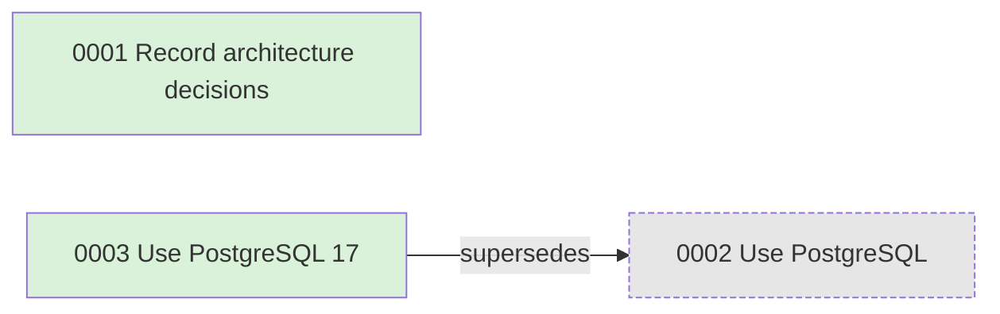

<h1 align="center">
  <picture>
    <source media="(prefers-color-scheme: dark)" srcset="https://raw.githubusercontent.com/maximiliancw/adrinaline/main/assets/brand/social/readme-banner-on-dark.png">
    
  </picture>
</h1>

[](https://github.com/maximiliancw/adrinaline/actions/workflows/ci.yml)
[](https://pypi.org/project/adrinaline/)
[](https://pypi.org/project/adrinaline/)
[](https://scorecard.dev/viewer/?uri=github.com/maximiliancw/adrinaline)

## Why

An Architecture Decision Record (ADR) is a short file that records one significant decision, the options considered and the consequences. Keeping them next to the code means new team members and coding agents can see why things are the way they are.

- One command bootstraps the practice: `adr init`.
- Plain Markdown with YAML frontmatter; hand edits stay first-class.
- Sequential numbering, with collisions between branches detected early.
- `adr check` validates the set in CI or pre-commit.
- Read-only git integration: it never stages, commits or fetches.
- The ADR set is a graph (text, Mermaid, DOT, JSON), tied to code via `scope` globs and queryable at any git revision.
- Every command has `--json`; `adr prime` briefs an agent at session start.

| | adrinaline | [adr-tools](https://github.com/npryce/adr-tools) | [log4brains](https://github.com/thomvaill/log4brains) | [MADR](https://adr.github.io/madr/) |
|---|---|---|---|---|
| What it is | Python CLI | Shell scripts | Node CLI + static site | Template only |
| Create, link, supersede | yes | yes | create from template | no CLI |
| Validation for CI (`adr check`) | yes | no | no | no |
| Decision graph export | text, Mermaid, DOT, JSON | graph generation | web UI | no |
| Agent briefing (`adr prime`) | yes | no | no | no |

Cells for the other tools reflect their READMEs; "no" means the feature is not documented there.

## Install

```bash
uv tool install adrinaline   # provides `adr` (and `adrinaline`)
# or run without installing:
uvx adrinaline --help
# or:
pipx install adrinaline
```

Requires git. Python 3.14+ is needed; `uv tool install` and `uvx` download it automatically if it is missing.

## Quick start

```bash
adr init                                   # docs/adr/.template.md + 0001-record-architecture-decisions.md
adr new "Use PostgreSQL" --tag storage --scope "src/db/**"  # docs/adr/0002-use-postgresql.md (proposed)
adr accept 2
adr new "Use PostgreSQL 17" --supersedes 2 --accepted
adr list
adr graph --format mermaid                 # paste into any GitHub/GitLab Markdown file
adr check                                  # CI-friendly validation
```

An ADR is a Markdown file with frontmatter (`docs/adr/0003-use-postgresql-17.md`):

```markdown
---
status: accepted
date: YYYY-MM-DD
supersedes: [2]
---
# Use PostgreSQL 17

## Context and Problem Statement

## Considered Options

## Decision Outcome

Chosen option: "…", because …

### Consequences

* Good, because …
* Bad, because …
```

### Status lifecycle

Statuses: `proposed`, `accepted`, `rejected`, `deprecated`, `superseded`.

| From | To | Command |
|---|---|---|
| (new) | proposed | `adr new` |
| (new) | accepted | `adr new --accepted` |
| proposed | accepted | `adr accept` |
| proposed | rejected | `adr reject` |
| accepted | deprecated | `adr deprecate` |
| accepted | superseded | `adr supersede` |

### Example output

`adr list`:

```text
0001  accepted    YYYY-MM-DD  Record architecture decisions
0002  superseded  YYYY-MM-DD  Use PostgreSQL
0003  accepted    YYYY-MM-DD  Use PostgreSQL 17
```

`adr prime --budget 150` (shortened):

```text
# ADR briefing

ADRs live in `docs/adr`: 2 accepted, 1 superseded.

## Decisions in force

- 0001 Record architecture decisions
- 0003 Use PostgreSQL 17

## Proposed

None.
```

`adr graph --format mermaid`:



## Tie decisions to code

Add `scope` globs to an ADR's frontmatter:

```yaml
scope: ["src/db/**", "migrations/**"]
```

Then:

```bash
adr for src/db/pool.py                     # which decisions govern this file?
adr check --diff origin/main --strict      # CI gate: changed files governed by ADRs in force
```

### CI

```yaml
- uses: actions/checkout@v7
  with:
    fetch-depth: 0   # shallow or fresh clones lack origin/main history, so --diff fails
- uses: astral-sh/setup-uv@v10.3.2
- run: uvx adrinaline check --diff origin/main --strict
```

Exit codes: `0` success, `1` `check` found problems, `2` usage error, `3` domain error (for example `not-found` or `no-adr-dir`).

## History

Every read command accepts `--at REF`:

```bash
adr list --at v1.2 --status accepted       # what was in force at release 1.2?
adr log 7                                  # git history of ADR 0007
```

Git access is read-only, and `adr log` only sees committed changes, so commit first.

## For coding agents

Install the skill, which teaches agents when and how to write ADRs:

| Agent | Install |
|---|---|
| Claude Code | `adr skill --install .claude/skills/adr` |
| Codex | `adr skill --install .agents/skills/adr` |
| Cursor | `adr skill --install .cursor/skills/adr` (also reads `AGENTS.md`) |
| GitHub Copilot | `adr skill --install .github/skills/adr` |

Codex, Cursor and Copilot all read `.agents/skills/`, so one install there covers all three. Rerun the install after upgrading `adr`.

Or add one line to `AGENTS.md` (or your agent's equivalent):

```markdown
Run `adr prime` at the start of every session and follow the ADRs it lists.
```

`adr prime --budget 400` limits the briefing to about 400 words, picking the most important and most relevant decisions first (the top-scored ADR is always shown). Agents create ADRs as `proposed`; humans accept them. Every command accepts `--json`.

## Commands

| Command | What it does |
|---|---|
| `init` | create the ADR directory, template and ADR 0001 |
| `new` | create a new ADR |
| `show` | show one ADR |
| `list` | list ADRs |
| `index` | print a Markdown index table |
| `accept` / `reject` / `deprecate` | set an ADR's status |
| `supersede` | mark OLD as superseded by NEW |
| `link` / `unlink` | add or remove a relation |
| `graph` | render the ADR graph |
| `renumber` | give an ADR a new number and update references |
| `log` | show the git history of an ADR |
| `for` | list the ADRs in force that govern each path |
| `check` | validate all ADRs |
| `prime` | print the agent briefing |
| `skill` | print or install the bundled agent skill |

Full documentation: <https://maximiliancw.github.io/adrinaline/>. Changelog: [GitHub Releases](https://github.com/maximiliancw/adrinaline/releases). This repo's own decisions are in [docs/adr/](docs/adr/).

## License

[MIT](LICENSE)
